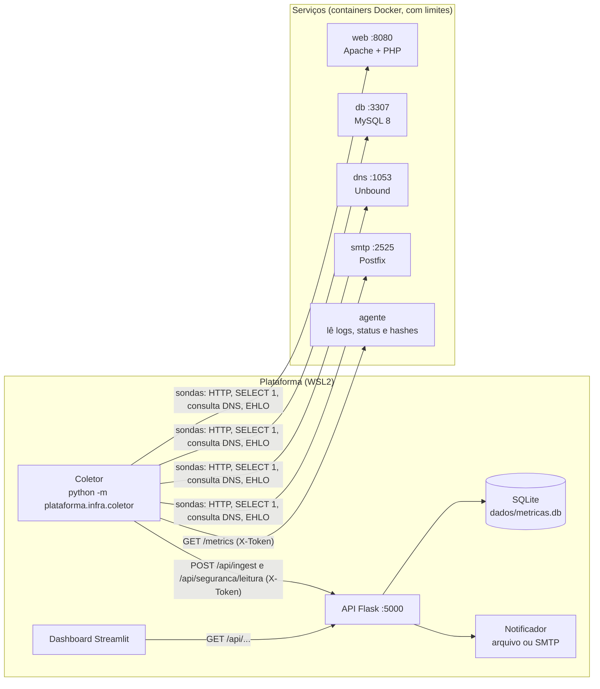

# Arquitetura da Plataforma de Monitoramento

> Versão final em Markdown (substitui o documento externo da 1ª versão). Os catálogos de métricas e de limites abaixo
> refletem `plataforma/contrato/metricas.py` e `config/regras.toml`; o teste `tests/test_docs.py` acusa se uma regra
> nova não for descrita aqui. Responsável: P2. Revisão: P3.

## 1. Objetivo e requisitos

Monitorar quatro serviços (web, banco de dados, DNS e SMTP) com **telemetria feita pela plataforma** (a plataforma vai
buscar os dados nos serviços), classificar a saúde de cada métrica em **OK / ATENÇÃO / CRÍTICO**, avisar por e-mail
quando o nível muda, detectar eventos de segurança e mostrar tudo em um dashboard.

Requisitos da disciplina atendidos por esta arquitetura:

| Requisito | Como é atendido |
| --- | --- |
| Plataforma separada dos serviços | Plataforma (Coletor, API, dashboard) e serviços em containers distintos (seção 2) |
| Um ataque a um serviço não derruba os outros | Cada container tem limite de CPU, memória e processos |
| Telemetria da plataforma para os serviços | O Coletor mede de fora (sondas) e lê o agente instalado ao lado dos serviços |
| Banco MySQL, DNS Unbound, SMTP Postfix | Containers `db`, `dns` e `smtp` (seção 2) |
| Alvo web vulnerável | Site "Receitas Práticas" (PHP + MySQL) com vulnerabilidades mantidas de propósito |
| Alertas e e-mail | Motor de alertas com histerese + notificador (seção 7) |
| Segurança (DDoS, força bruta, alteração de configuração) | Seção 8 |
| Sem segredos no repositório | Tudo sensível vem do `.env` (seção 10) |

## 2. Visão de implantação

A decisão de 20/11 (ver `docs/LOG.md`) foi usar **WSL2 + Docker**: a plataforma roda no WSL (VM Linux leve) e os quatro
serviços em containers, com portas alternativas publicadas só em `127.0.0.1` para não conflitar com o XAMPP e o Windows.



| Serviço | Container | Porta no host | Limites |
| --- | --- | --- | --- |
| web | `web` (php:8.3-apache) | 8080 | 1 CPU, 512 MB, 200 processos |
| banco | `db` (mysql:8.0) | 3307 | 1 CPU, 1 GB, 300 processos |
| DNS | `dns` (Unbound) | 1053 | 0,5 CPU, 256 MB, 100 processos |
| SMTP | `smtp` (Postfix) | 2525 | 0,5 CPU, 256 MB, 100 processos |

Risco registrado: plataforma e serviços compartilham a mesma máquina; o isolamento vem dos limites dos containers.

## 3. Visão lógica: camadas

O código é dividido em camadas e cada arquivo só importa da própria camada ou das de baixo (verificado por
`tests/test_camadas.py`).

| Camada | Pasta | Conteúdo |
| --- | --- | --- |
| 0 contrato | `plataforma/contrato/` | catálogo de métricas, validação do lote, leitura de configuração |
| 1 domínio | `plataforma/dominio/` | regras puras: alertas (`alertas.py`), taxas (`taxas.py`), derivadas do agente (`derivadas.py`), derivadas do banco (`derivadas_db.py`), segurança (`seguranca.py`) |
| 2 infra | `plataforma/infra/` | sondas, cliente do agente, Coletor, banco SQLite, notificador |
| 3 api | `plataforma/api/` | rotas Flask |
| 4 dashboard | `plataforma/dashboard/` | Streamlit, lê dados só pela API |

`servicos/agente/` é um programa separado (roda ao lado dos serviços) e não importa nada de `plataforma/`.

## 4. Fluxo de um ciclo (a cada 15 s)

```mermaid
sequenceDiagram
    participant C as Coletor
    participant S as Serviços
    participant G as Agente
    participant A as API
    participant B as SQLite
    participant N as Notificador
    C->>S: sondas (disponibilidade e latência; contadores do MySQL)
    C->>G: GET /metrics
    C->>C: derivar taxas e percentuais (precisa da leitura anterior)
    C->>A: POST /api/ingest (lote de amostras)
    A->>B: grava amostras
    A->>A: z-score de web.rps e dns.qps (DDoS)
    A->>A: avalia cada regra (histerese)
    A->>N: e-mail se o nível mudou
    C->>A: POST /api/seguranca/leitura (login e hashes)
    A->>N: e-mail se houver evento novo
```

Regras de coleta:

- **Sonda caixa-preta** testa o serviço como um usuário: HTTP com status < 500, `SELECT 1` no MySQL, consulta A ao
  Unbound, banner 220 + EHLO 250 + QUIT no Postfix. Uma porta aberta que não responde o protocolo conta como fora do ar.
- **Agente caixa-branca** entrega contadores e contagens que só se veem por dentro (mod_status, log do site, estatísticas
  do Unbound, log e fila do Postfix, CPU/memória/disco).
- Métrica que não dá para calcular (sem leitura anterior, contador que diminuiu porque o serviço reiniciou, divisão por
  zero, agente fora do ar) é **omitida**: nunca se inventa valor. No primeiro ciclo não há taxas.
- O Coletor guarda em memória (`Memoria`) a leitura anterior do agente e do MySQL e as leituras do banco dos últimos
  10 min (para `db.crescimento_mb_dia`).

## 5. Catálogo de métricas

Nome, unidade e descrição vêm do contrato. "Fonte" diz de onde o valor é medido. Os limites são os de `config/regras.toml`
(— = métrica informativa, sem regra; aparece só no dashboard).

| Métrica | Unidade | Descrição | Fonte | ATENÇÃO | CRÍTICO |
| --- | --- | --- | --- | --- | --- |
| `web.disponivel` | 0/1 | Responde HTTP com status < 500 | sonda | < 1 | < 1 |
| `web.latencia_ms` | ms | Tempo total da sonda HTTP | sonda | > 500 | > 2000 |
| `web.latencia_p95_ms` | ms | Percentil 95 do tempo de servidor (log) | agente | > 300 | > 1000 |
| `web.rps` | req/s | Requisicoes por segundo (mod_status) | agente | — | — |
| `web.taxa_erro_4xx_pct` | % | Respostas 4xx sobre o total da janela | agente | > 20 | > 50 |
| `web.taxa_erro_5xx_pct` | % | Respostas 5xx sobre o total da janela | agente | > 2 | > 10 |
| `web.req_4xx` | requisicoes | Contagem de respostas 4xx na janela | agente | — | — |
| `web.req_5xx` | requisicoes | Contagem de respostas 5xx na janela | agente | — | — |
| `web.conexoes_ativas` | conexoes | ConnsTotal do mod_status | agente | > 100 | > 180 |
| `db.disponivel` | 0/1 | Conecta e executa SELECT 1 | sonda MySQL | < 1 | < 1 |
| `db.latencia_ms` | ms | Tempo da sonda do banco | sonda MySQL | > 100 | > 1000 |
| `db.qps` | consultas/s | Diferenca de Questions por segundo | sonda MySQL | > 300 | > 1000 |
| `db.rollbacks_s` | /s | Diferenca de Com_rollback por segundo | sonda MySQL | > 1 | > 5 |
| `db.conexoes_abortadas` | conexoes | Diferenca de Aborted_connects | sonda MySQL | > 5 | > 20 |
| `db.conexoes` | conexoes | Threads_connected | sonda MySQL | — | — |
| `db.conexoes_executando` | conexoes | Threads_running | sonda MySQL | > 20 | > 50 |
| `db.uso_conexoes_pct` | % | Threads_connected / max_connections | sonda MySQL | > 70 | > 90 |
| `db.threads_cache` | threads | Threads_cached | sonda MySQL | — | — |
| `db.tamanho_mb` | MB | data_length + index_length | sonda MySQL | > 2000 | > 4000 |
| `db.crescimento_mb_dia` | MB/dia | Crescimento projetado para 24 h | sonda MySQL | > 500 | > 2000 |
| `db.slow_queries_min` | consultas/min | Diferenca de Slow_queries por minuto | sonda MySQL | > 5 | > 30 |
| `dns.disponivel` | 0/1 | Resposta valida em ate 2 s | sonda | < 1 | < 1 |
| `dns.latencia_ms` | ms | Tempo de resolucao da consulta de teste | sonda | > 100 | > 500 |
| `dns.qps` | consultas/s | Diferenca de total.num.queries por segundo | agente | > 100 | > 500 |
| `dns.taxa_erro_pct` | % | SERVFAIL + REFUSED + falhas da sonda sobre o total | agente | > 5 | > 20 |
| `smtp.disponivel` | 0/1 | Banner 220, EHLO e QUIT na porta 25 | sonda | < 1 | < 1 |
| `smtp.latencia_ms` | ms | Tempo do dialogo da sonda SMTP | sonda | > 1000 | > 5000 |
| `smtp.taxa_entrega_pct` | % | sent / (sent + deferred + bounced) | agente | < 95 | < 80 |
| `smtp.fila` | mensagens | Mensagens na fila (postqueue -j) | agente | > 20 | > 100 |
| `smtp.latencia_envio_s` | s | Media do campo delay= do log | agente | > 5 | > 30 |
| `smtp.rejeicoes` | contagem | Linhas reject no log da janela | agente | > 5 | > 20 |
| `smtp.timeouts` | contagem | Linhas timeout no log da janela | agente | > 1 | > 5 |
| `smtp.taxa_erro_pct` | % | (rejeicoes + timeouts) sobre o total | agente | > 5 | > 20 |
| `smtp.emails_min` | e-mails/min | Mensagens enviadas por minuto | agente | > 60 | > 200 |
| `host.cpu_pct` | % | Uso de CPU | agente | > 80 | > 95 |
| `host.mem_pct` | % | Uso de memoria | agente | > 80 | > 95 |
| `host.disco_io_kbs` | KB/s | Leitura + escrita em disco | agente | > 50000 | > 200000 |
| `host.disco_latencia_ms` | ms | Tempo de I/O por operacao | agente | > 20 | > 100 |

## 6. Contrato da API

Escrita exige o cabeçalho `X-Token` (valor em `MONITOR_TOKEN`); leitura é aberta na rede local.

| Rota | Método | Quem usa | O que faz |
| --- | --- | --- | --- |
| `/api/ingest` | POST | Coletor | recebe `{"ts": epoch, "amostras": [{"servico", "metrica", "valor"}]}`; 400 se sair do catálogo, 401 sem token |
| `/api/status` | GET | dashboard | pior nível por serviço (`SEM_DADOS` se nunca houve amostra) |
| `/api/metricas?metrica=&desde=&ate=` | GET | dashboard | série temporal de uma métrica |
| `/api/alertas?limite=` | GET | dashboard | últimos alertas (mudanças de nível) |
| `/api/saude` | GET | dashboard e testes | 200 se houve coleta nos últimos 60 s, senão 503 |
| `/api/seguranca/leitura` | POST | Coletor | recebe `{"ts", "auth": [...], "hashes": {caminho: sha256}}` do agente e avalia força bruta e alteração de arquivos |
| `/api/seguranca/linha-base` | POST | operador | aceita os hashes atuais como linha de base (409 se ainda não houve leitura) |
| `/api/seguranca?limite=` | GET | dashboard | últimos eventos de segurança e a linha de base |

Exemplo de lote:

```json
{"ts": 1795036800, "amostras": [
  {"servico": "web", "metrica": "web.disponivel", "valor": 1},
  {"servico": "db", "metrica": "db.uso_conexoes_pct", "valor": 19.868}
]}
```

## 7. Alertas

Cada métrica com regra tem uma máquina de estados com histerese (`plataforma/dominio/alertas.py`):

- **Subir de nível:** a violação precisa se repetir `subir` amostras seguidas (padrão 2).
- **Descer de nível:** `descer` amostras seguidas abaixo do nível atual (padrão 3).
- **Disponibilidade** (`atencao_imediata`): a 1ª falha já vai para ATENÇÃO; a 2ª vai para CRÍTICO.
- Operador `>` alerta acima do limite; `<` alerta abaixo.
- Cada mudança de nível grava um alerta e dispara um e-mail pelo notificador. Se o envio falhar, o alerta fica gravado
  com `email_enviado = 0` e o erro vai para o log da API.
- `db.crescimento_mb_dia` usa `subir = 3`, porque é uma projeção sensível a variações pequenas.

Os limites são **iniciais** e devem ser recalibrados com a linha de base medida nos testes (`docs/LOG.md`).

## 8. Segurança

Três detecções, todas gravam em `evento_seguranca` e mandam e-mail (`plataforma/dominio/seguranca.py`):

| Tipo | Detecção | ATENÇÃO | CRÍTICO |
| --- | --- | --- | --- |
| `TRAFEGO` (DDoS) | escore z de `web.rps` e `dns.qps` contra a última hora (precisa de 20 amostras; piso de desvio de 5 para não disparar com tráfego ocioso; só aumento conta) | z ≥ 3 | z ≥ 5 |
| `AUTENTICACAO` (força bruta) | falhas de login por IP em 60 s (cada IP é avaliado sozinho) | 5 falhas | 20 falhas |
| `CONFIGURACAO` | hash de arquivo diferente da linha de base | — | sempre |

- **Sem repetição:** um aviso só se repete se o nível subir, ou depois de 5 min (TRAFEGO e AUTENTICACAO). Alteração de
  arquivo avisa uma vez por mudança de hash.
- **Linha de base:** com o sistema limpo, depois de uma leitura do agente, rodar
  `curl -X POST -H "X-Token: $MONITOR_TOKEN" http://127.0.0.1:5000/api/seguranca/linha-base`. Repetir depois de cada
  mudança legítima de configuração. Arquivo novo ou ausente não gera evento.
- O serviço de cada evento de arquivo é inferido do caminho (`postfix` → smtp, `unbound` → dns, `mysql` → db,
  `apache`/`/var/www` → web, senão host).
- Não implementado: eventos `VULNERABILIDADE` (a tabela os aceita).

## 9. Modelo de dados (SQLite, modo WAL)

| Tabela | Colunas principais | Uso |
| --- | --- | --- |
| `amostra` | ts, servico, metrica, valor (índice em metrica, ts) | séries temporais |
| `estado_alerta` | metrica, servico, nivel, desde, seq_violacao, seq_normal | estado atual da histerese |
| `alerta` | ts, servico, metrica, nivel_anterior, nivel_novo, valor, limite, email_enviado | histórico de mudanças de nível |
| `evento_seguranca` | ts, tipo, servico, nivel, origem, detalhe | eventos da seção 8 |
| `tentativa_login` | ts, origem, usuario, sucesso | base da contagem de falhas por IP |
| `hash_arquivo` | caminho, atual, ts_atual, base, desde_base | hash mais recente e linha de base |

## 10. Configuração e segredos

Arquivos em `config/` (TOML) descrevem o que é vigiado; segredos e caminhos ficam no `.env`, que **não** vai para o
repositório (`.gitignore`). O repositório só tem `.env.exemplo`, sem valores.

| Variável | Para quê |
| --- | --- |
| `MONITOR_TOKEN` | token de escrita da API (obrigatória) |
| `MONITOR_API_URL`, `MONITOR_DB`, `MONITOR_CONFIG_DIR` | endereço da API, caminho do SQLite e pasta de configuração |
| `MONITOR_DB_SENHA`, `MONITOR_DB_USUARIO` | acesso do Coletor ao MySQL (usuário `monitor`, só `SELECT` e `PROCESS`) |
| `MONITOR_DNS_CONSULTA` | nome consultado pela sonda DNS (padrão `teste.lab.local`) |
| `MONITOR_AGENTE_URL` (ou `agente_url` em `servicos.toml`), `MONITOR_AGENTE_TOKEN` | agente de telemetria |
| `NOTIFICADOR`, `NOTIF_DIR`, `SMTP_*`, `ALERTA_DESTINO` | e-mail de alerta (modo `arquivo` nos testes, `smtp` de verdade) |

## 11. Qualidade e testes

- `pytest` roda tudo; `MONITOR_INFRA=1 pytest tests/test_infra.py` confere os containers reais.
- **Teste termômetro** (`tests/test_termometro.py`): API e Coletor em processos separados contra serviços falsos; prova a
  cadeia coleta → API → banco → alerta → e-mail → status.
- **Teste de sabotagem:** cada verificação tem um caso que estraga o resultado (servidor fora do ar, token errado,
  contador que diminui…) e exige que o teste acuse.
- Camadas verificadas por `tests/test_camadas.py`.

## 12. Premissas e limitações

- **Agente:** assume que `log_web` e `postfix` trazem contagens da janela desde a leitura anterior, que `apache` e
  `unbound` são contadores acumulados e que `auth` traz as tentativas novas (sem repetir as já enviadas). A confirmar com P1.
- `smtp.taxa_erro_pct` usa como total `sent + deferred + bounced + rejeições + timeouts`; `web.latencia_p95_ms` usa o
  posto mais próximo.
- Os relógios do agente e da plataforma precisam estar em sincronia (a janela de 60 s do login usa o horário do agente).
- A leitura de segurança só é enviada quando o agente respondeu naquele ciclo.
- O SQLite só cresce: `Banco.apagar_antigas(dias=7)` existe, mas nem a API nem o Coletor a chamam ainda, e `tentativa_login` não tem limpeza. Pendência para depois da apresentação.
- `HOST` pode aparecer em `/api/status` quando o agente envia métricas `host.*` (o dashboard deve prever o serviço extra).
